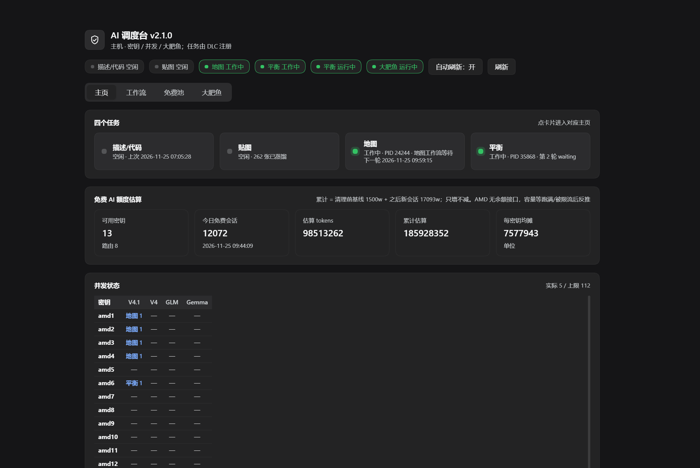

# AI Console / AI 调度台



A DSH desktop plugin that puts task scheduling, concurrency, free-pool discovery, local tools and the optional mod console into one left-sidebar panel.

一个 DSH 桌面插件：把任务调度、并发、免费池、本机工具和可选的模组控制台集中到左栏面板。

---

## English

### What it is

AI Console is a local-first scheduler for DSH. It watches the tasks you run on your own machine, shows which model/key slot is busy, and exposes a small local API so agents, scripts and a QQ bot can call the same tools.

It started as a process watcher for a mod pipeline that used free AI. The free pool was not efficient enough, so the watcher became a scheduler. Later the project was split into:

- `ai-hub` (this repository): scheduler
- `task-mod`: optional mod console for maps, textures and balance

### Features

- Task overview: code, map, texture and balance tasks with batch, progress, workers and keys
- Concurrency matrix: local key pool × models, busy and idle slots, per-model show/hide
- Model module: three states per model (disabled / backup / active), all provider pools listed
- Schedule tab: read and delete DSH scheduled tasks
- Auto-scaling: start extra workers when idle slots exceed a threshold
- Free-pool discovery: parse public GitHub lists into provider candidates, base URLs and free quotas
- Map tools: wish-based naming, spawn/resource validation, diff checks
- Asset tools: GitHub map/mod search, local asset index, rtsbox community scraper
- Browser search: local Edge screenshot + DOM text, no search API
- Task telemetry: tokens, duration and anomalies by task type
- Self-check: plugin syntax, config, token ledger, map rules, monitors
- Local API for tools and QQ bot

### Requirements

- DSH Desktop (Windows)
- Python 3.11
- Node runtime bundled with DSH
- Optional: Rusted Warfare + Tiled/TMX tools for the mod workflow
- Optional: `task-mod` for the mod console

### Install

1. Open DSH Desktop.
2. Go to **Settings → Plugins**.
3. Install this folder as a local bundle (or clone this repository and select the folder).
4. Restart DSH if the left-sidebar icon does not appear.
5. Open **AI Console** from the left sidebar.

```powershell
git clone https://github.com/Railan1314/dsh-plugin-ds-console.git
```

There is no npm build step; the plugin is plain ES modules.

### Configuration

Main settings:

```text
tools/ds_console_settings.json
```

Common fields:

```json
{
  "auto": true,
  "idleThreshold": 0.3,
  "expandTasks": 8,
  "mapAuto": true,
  "balanceAuto": true,
  "qqNotify": true
}
```

Local scripts and secrets are outside this repository. **Never commit API keys, tokens or notification configs.**

### Local API

Loopback only:

```text
GET  /dsh-console/api/status
GET  /dsh-console/api/tasks
POST /dsh-console/api/tasks   {id, op}
POST /dsh-console/api/tool    {action, ...}
```

Tool actions include:

```text
github / github-mods / community / community-scout
browser-search / assets / asset-index / mapvalidate
self-check / power / resource / task
```

### Security

- The plugin does not read or write API keys.
- `/dsh-console/api/*` is bound to localhost and has no token auth; do not expose DSH to the public internet.
- Before publishing, remove `tools/dsh_config.json`, `tools/notify_config.json`, `tools/token_ledger.json` and personal data.
- This is a personal/beta project; no cross-version compatibility guarantee.

### Known limits

- The matrix uses local key aliases, not real account identities.
- The map validator's "resource" check is a non-empty tile check, not a strict resource-pool type check.
- Headless Bing/Baidu may hide visual results behind anti-bot; DOM text is still saved.

---

## 中文

### 这是什么

AI 调度台是一个本机优先的 DSH 调度插件。它观察你机器上的任务，显示当前哪个模型/key 槽位在忙，并提供一个小型本机 API，让 agent、脚本和 QQ 机器人调用同一套工具。

最初只是想写个进程守护，让免费 AI 帮忙写模组；后来发现免费池效率不够，就把守护做成了调度台。再后来不想直接做模组内容，于是拆成两个插件：

- `ai-hub`（本仓库）：调度台
- `task-mod`：可选模组控制台，负责地图/贴图/平衡

不需要模组的人只装调度台即可。

### 功能

- 任务总览：代码、地图、贴图、平衡的状态、批次、进度、worker/key
- 并发矩阵：本地 key 池 × 模型，显示实际占用和空闲槽位，可按模型显示/关闭
- 模型模块：不启用 / 备选 / 启用三态，所有池子模型都列出
- 定时页：读取 DSH 定时任务并支持删除
- 自动扩展：空闲槽位超过阈值时拉起额外任务
- 免费池侦察：解析公开 GitHub 清单，输出 provider、base URL、免费额度
- 地图工具：许愿式命名、出生点/矿校验、差异化检查
- 素材工具：GitHub 地图/模组搜索、桌面素材索引、rtsbox 社区抓取
- 浏览器搜索：本机 Edge 截图 + DOM 文本，不走搜索 API
- 任务遥测：按任务类型记录 token、耗时和异常
- 自检：插件语法、配置、token 账本、地图规则、监控
- 本机 API：给工具和 QQbot 共用

### 安装

1. 打开 DSH Desktop
2. 进入 **设置 → 插件**
3. 选择本目录作为本地 bundle 安装
4. 左侧没有图标就重启 DSH
5. 从左栏打开 **AI 调度台**

```powershell
git clone https://github.com/Railan1314/dsh-plugin-ds-console.git
```

没有 npm 构建步骤，插件是普通 ES module。

### 依赖

- DSH Desktop（Windows）
- Python 3.11
- DSH 自带 Node runtime
- 可选：铁锈战争 + Tiled/TMX 工具
- 可选：`task-mod` 模组控制台

### 配置

```text
tools/ds_console_settings.json
```

常用项：

```json
{
  "auto": true,
  "idleThreshold": 0.3,
  "expandTasks": 8,
  "mapAuto": true,
  "balanceAuto": true,
  "qqNotify": true
}
```

本机脚本和密钥不在本仓库内。**不要提交 API key、token 或通知配置。**

### 安全

- 插件不读取、不写入 API key
- `/dsh-console/api/*` 只绑本机回环，不做 token 鉴权；不要把 DSH 暴露到公网
- 发布前删除 `tools/dsh_config.json`、`tools/notify_config.json`、`tools/token_ledger.json` 和个人数据
- 个人/beta 项目，不保证跨 DSH 版本兼容

### 已知限制

- 并发矩阵的 key 名称是本地别名，不对应真实账号
- 地图校验里的“矿”目前只检查非空资源格，不是严格资源池类型
- 无头 Bing/百度可能被反爬隐藏结果，DOM 文本仍会保存

### 来历

最初只想写个进程守护，让免费 AI 帮忙写模组；后来发现免费池效率不够，就把守护做成了调度台。再后来不想直接做模组内容，于是拆成调度台 + 模组控制台。

---

## License

MIT. See [LICENSE](LICENSE).

## Links

- Issues: https://github.com/Railan1314/dsh-plugin-ds-console/issues
- Releases: https://github.com/Railan1314/dsh-plugin-ds-console/releases
